 <div align="center">


<a href="https://git.io/typing-svg">

</a>

<br/>

<a href="mailto:rafaelssoni1000@gmail.com"></a>
<a href="https://www.linkedin.com/in/rfmota/"></a>
<a href="https://github.com/rfmotaa"></a>
<a href="https://leetcode.com/u/rf_motaa/"></a>

</div>

---

<h2 align="center">⚡ About Me</h2>

```java
public class RafaelMota {

    String role = "Backend Software Engineer";
    String location = "São Paulo, Brazil";
    String education = "Systems Analysis and Development @ IFSP";

    String[] interests = {
        "Backend Engineering",
        "Software Architecture",
        "Distributed Systems",
        "Cloud Computing",
        "Problem Solving"
    };

    String mindset = "Always learning. Always building.";
}
```

<div align="center">

|  |  |  |
|:---:|:---:|:---:|

</div>

Currently completing my degree at **IFSP**, with expected graduation in December 2026.

Working as a **Software Development Intern at Mundiale**, focusing on backend development with Node.js.

I enjoy designing APIs, solving engineering problems, understanding system architecture and building maintainable software.

---

<h2 align="center">💼 Experience & Leadership</h2>

<table>
<tr>
<td width="65">


</td>
<td>

### Software Development Intern — Mundiale

`2026 – Present`

Backend development with Node.js, working on software features and real-world application requirements.

</td>
</tr>
<tr>
<td>


</td>
<td>

### Google Student Ambassador — Google

`August 2026 – December 2026`

Promoting Google's technologies and AI ecosystem within the university, leading knowledge-sharing initiatives and Google Workspace study groups.

</td>
</tr>
<tr>
<td>


</td>
<td>

### Lead Developer & Software Architect — GiroRapido

`August 2026 – Present`

Designing the architecture and leading the technical implementation of a SaaS platform for automotive businesses, focused on market intelligence and business dashboards.

</td>
</tr>
</table>

---

<h2 align="center">🛠️ Technology Stack</h2>

<h3 align="center">Backend Development</h3>

<div align="center">


<br/>


</div>

<h3 align="center">Databases & Data</h3>

<div align="center">


<br/>


</div>

<h3 align="center">Frontend Development</h3>

<div align="center">


</div>

<h3 align="center">DevOps, Cloud & Tools</h3>

<div align="center">


<br/>


</div>

---

<h2 align="center">🚀 Featured Projects</h2>

<div align="center">

<a href="https://github.com/rfmotaa?tab=repositories">

</a>

</div>

<table>
<tr>
<td width="50%">

<h3 align="center">🚗 GiroRapido</h3>

<div align="center">


</div>

A SaaS platform for automotive businesses, providing market intelligence and business dashboards.

**Focus:**
- Software architecture
- Backend engineering
- Business intelligence

</td>
<td width="50%">

<h3 align="center">💻 Engineering Projects</h3>

<div align="center">


</div>

Practical implementations exploring software engineering concepts and programming fundamentals.

**Focus:**
- Data structures and algorithms
- API development
- Software design patterns

</td>
</tr>
</table>

---

<h2 align="center">🎓 Education & Research</h2>

<div align="center">

**Federal Institute of São Paulo — IFSP**

Systems Analysis and Development


<br/><br/>

**Academic Research**


Co-author of an academic research article published in RECIMA21.

<a href="https://recima21.com.br/recima21/pt_BR/article/view/8232">

</a>

</div>

---

<h2 align="center">🧠 Problem Solving</h2>

<div align="center">

<a href="https://leetcode.com/u/rf_motaa/">

</a>

<br/><br/>

Studying Data Structures, Algorithms, Complexity Analysis and Problem Solving.

</div>

---

<h2 align="center">📚 Currently Exploring</h2>

<div align="center">


<br/><br/>


<br/><br/>


</div>

---

<h2 align="center">🌎 Languages</h2>

<div align="center">


</div>

---

<div align="center">

<h3>🐍 Contributions</h3>


<br/><br/>




### `console.log("Thanks for visiting my profile! 🚀");`

**Building today. Engineering tomorrow.**

<a href="https://github.com/rfmotaa?tab=repositories">

</a>

</div>


